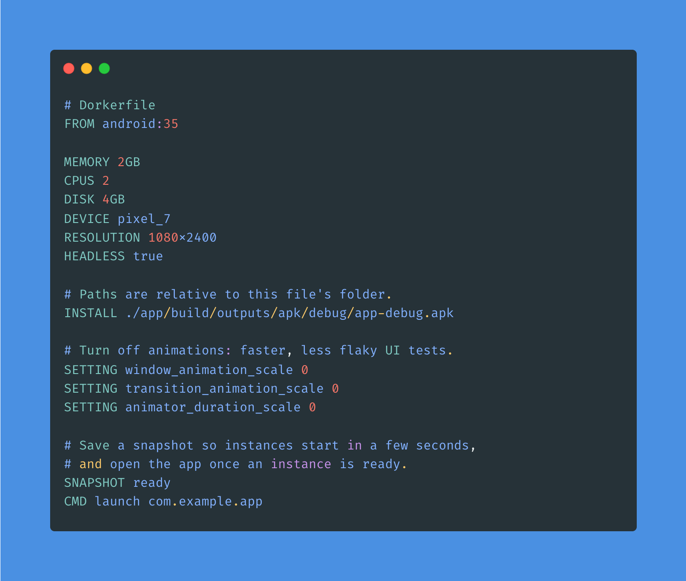

# dorker

**Docker for headless Android emulator environments.**

dorker runs the official Android Emulator without a window. Describe an environment in a `Dorkerfile`, build it once into an immutable image (with a snapshot, so it starts in seconds), and start as many isolated, disposable instances as you need. Use it for UI tests, screenshots, CI, and for handing an agent a device. It is not an emulator of its own and needs the Android SDK.

## Why dorker

- **Describe it once.** A `Dorkerfile` is the environment: Android version, resources, the APK, settings, and a snapshot.
- **Start in seconds.** The image keeps a snapshot. A new instance restores it instead of cold booting.
- **Isolated by default.** Every `dorker run` gets its own copy, so instances never share state.
- **Agent-native.** `dorker mcp` lets an agent start instances, install apps, take screenshots, and run tests.
- **No Docker required.** It drives the official emulator on the host. macOS Apple Silicon and Linux x86_64 with KVM are validated.

## Start here

1. [Install](getting-started/install.md)
2. [Quick start](getting-started/quick-start.md)
3. [Dorkerfile](dorkerfile.md)

## Learn by goal

| I want to… | Go to |
|---|---|
| Install dorker | [Install](getting-started/install.md) |
| Boot a headless emulator | [Quick start](getting-started/quick-start.md) |
| Understand images, instances, and snapshots | [Images and instances](concepts/images-and-instances.md) |
| Write a Dorkerfile | [Dorkerfile](dorkerfile.md) |
| Look up a command | [Core commands](commands/core.md) |
| Build an image and run it | [Build and run](workflows/build-and-run.md) |
| Start from a template | [Templates](templates.md) |
| Run instrumentation tests, including in parallel | [Testing](workflows/testing.md) |
| See what is using disk, or free it | [Disk and cleanup](workflows/disk.md) |
| Hand a device to an AI agent | [AI agents](mcp.md) |
| Point dorker at another SDK or disk | [Configuration](configuration/index.md) |
| Read the design and the module map | [Architecture](architecture.md) |
| See measured boot, restore, and GPU numbers | [Benchmarks](benchmarks.md) |
| Check platform limits and exit codes | [Limitations](reference/limitations.md) |
| Build, test, or release dorker itself | [Development](reference/development.md) |
